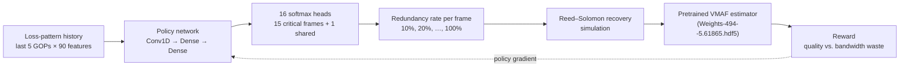

<div align="center">

# RL-AFEC

**Adaptive Forward Error Correction for Real-time Video Communication Based on Reinforcement Learning**

[](https://dl.acm.org/doi/10.1145/3524273.3528184)
[](https://doi.org/10.1145/3524273.3528184)
[](#installation)
[](#installation)
[](LICENSE)

[Paper](https://dl.acm.org/doi/10.1145/3524273.3528184) ·
[PDF](https://s18798.pcdn.co/minghao/wp-content/uploads/sites/28082/2023/07/ACM_MMsys.pdf) ·
[Citation](#citation)

</div>

---

Official TensorFlow implementation of **RL-AFEC** (ACM MMSys 2022). Real-time video calls cannot wait for retransmissions, so senders add redundant
FEC packets to survive packet loss. Too little redundancy and the video freezes; too much and bandwidth is wasted. RL-AFEC uses a reinforcement-learning
agent to choose a **per-frame Reed–Solomon redundancy rate** from the recent loss history and the video content. A **packet-level VMAF estimator**
scores the result, so training and evaluation need only packet traces, not decoded video.

In the paper, RL-AFEC achieves good video quality in more than 95% of cases while spending only about 40% additional bandwidth on redundant packets,
outperforming the baseline FEC schemes.

## How it works



- **State:** one sample describes a 30-frame window with 90 features: per-frame packet loss rate (0–29), normalized frame size (30–59) and motion
  features (60–89). The agent sees the last `tm_history = 5` samples.
- **Action:** the first `critical_num = 15` frames each get their own redundancy rate, and the remaining frames share one, which gives 16
  choices from `actions_pool = [0.1, …, 1.0]`.
- **Reward:** above the VMAF target (80) the agent gets a fixed bonus minus a penalty for wasted redundancy bandwidth. Below it, the reward is a
  penalty that grows as quality drops.
- **Training:** REINFORCE with a per-state average-reward baseline, using several parallel experience-collecting agents and one central learner.

## Installation

```bash
git clone https://github.com/kchen-dale/RL-AFEC.git
cd RL-AFEC
pip install -r requirements.txt
```

**Supported Python: 3.10 – 3.13.** The upper limit comes from TensorFlow: 2.21 has no packages for Python 3.14 or newer. No GPU is required.

[requirements.txt](requirements.txt) pins TensorFlow and gives version ranges for everything else. pip picks the NumPy release that matches your Python
(NumPy 2.5 needs Python ≥ 3.12). Training, testing and the pretrained weights were verified with:

| Package | Python 3.10 | Python 3.13 |
| --- | --- | --- |
| Python | 3.10.22 | 3.13.7 |
| tensorflow | 2.21.0 | 2.21.0 |
| keras | 3.12.4 | 3.15.1 |
| numpy | 2.2.6 | 2.5.4 |
| h5py | 3.14.0 | 3.14.0 |
| tensorboard | 2.21.0 | 2.21.0 |
| absl-py | 2.5.1 | 2.5.1 |
| tqdm | 4.70.1 | 4.70.1 |

> TensorFlow 2.21 requires `h5py < 3.15`, so h5py is not the newest release.
>
> The paper's experiments were run with Python 3.6.8 and TensorFlow 2.2.0 (CPU). That setup has not been retested with the current code.

## Quick start

All commands are run from the repository root.

### Train

```bash
python3 train.py --num_agents=11 --num_iter=100
```

| Flag | Default | Meaning |
| --- | --- | --- |
| `--num_agents` | `5` | Parallel experience-collecting processes. A good value is CPU cores − 1, and `0` picks that automatically. |
| `--num_iter` | `100` | Samples each agent collects per training step. |
| `--baseline` | `avg` | Advantage baseline: `avg` (running average reward per state) or `best` (reward of the greedy action). |

The training trace is set by `trace_file` in [config.py](config.py), and the number of training steps by `max_step`. Checkpoints go to
`tf_ckpts/RL-RS_1.0-pure_policy_<trace_file>/`, and TensorBoard logs go to `logs/`:

```bash
tensorboard --logdir logs
```

### Test

The repository does not include a trained RL policy, so train one first. Then set `test_trace_file` in [config.py](config.py) to any trace under `data/`, for example `video_RL_testing.txt` or
`Emulation_video_test/foreman/foreman_0.1.txt`, then run:

```bash
python3 test.py                 # latest checkpoint
python3 test.py --ckpt=ckpt-50  # a specific checkpoint
```

Each run writes two files to the working directory:

| File | One line per sample |
| --- | --- |
| `eval_results_<trace>` | `<sample> [a_0, …, a_15] <predicted VMAF> <wasted bandwidth in bytes>`, where action index `a` means redundancy rate `actions_pool[a]` |
| `loss_pattern_after_<trace>` | residual per-frame loss rate of the 30 frames after FEC recovery |

## Pretrained VMAF estimator

[Weights-494--5.61865.hdf5](Weights-494--5.61865.hdf5) is the pretrained packet-level quality estimator that the reward is computed from. It is a
small MLP (90 → 90 → 90 → 1) that maps a 90-d loss pattern to a VMAF score without needing the decoded video. You can use it directly:

```python
import numpy as np
from get_vq import get_video_quality

pattern = np.loadtxt('data/test_t.txt', dtype=np.float32)[:1]   # shape (1, 90)
print(get_video_quality(pattern))                               # VMAF in [0, 100]
```

## Data

| Path | Contents |
| --- | --- |
| `data/video_RL_train.txt` | ≈45k training samples |
| `data/video_RL_testing.txt` | ≈4.5k test samples |
| `data/test_t.txt` | 200-sample trace for a quick sanity check |
| `data/Emulation_video_test/<video>/<video>_<loss>.txt` | emulation traces for 8 standard sequences (akiyo, coastguard, container, foreman, hall, mobile, mother_daughter, news) at packet loss rates from 0.1% to 20%; each `.csv` holds the same samples with a header row |

Every line of a trace is one sample: 90 space-separated floats in the layout described under [How it works](#how-it-works).

## Repository layout

| File | Role |
| --- | --- |
| [train.py](train.py) | Multi-process training: one central learner plus `num_agents` experience collectors |
| [test.py](test.py) | Greedy evaluation of a checkpoint on `test_trace_file` |
| [config.py](config.py) | All hyperparameters (network, learning rate, action space, traces) |
| [env.py](env.py) | Loads a trace file into loss patterns |
| [game.py](game.py) | Builds states, simulates FEC recovery and computes the reward and baseline |
| [model_mine.py](model_mine.py) | Policy network, policy-gradient loss, checkpointing and summaries |
| [RS_decode_video.py](RS_decode_video.py) | Reed–Solomon recovery model: lost vs. redundant packets per frame |
| [video_quality.py](video_quality.py), [get_vq.py](get_vq.py) | VMAF estimator definition and inference helper |

## Citation

If you find this work useful, please cite:

```bibtex
@inproceedings{chen2022rlafec,
  title     = {{RL-AFEC}: Adaptive Forward Error Correction for Real-time Video Communication Based on Reinforcement Learning},
  author    = {Chen, Ke and Wang, Han and Fang, Shuwen and Li, Xiaotian and Ye, Minghao and Chao, H. Jonathan},
  booktitle = {Proceedings of the 13th ACM Multimedia Systems Conference (MMSys '22)},
  pages     = {96--108},
  year      = {2022},
  publisher = {ACM},
  doi       = {10.1145/3524273.3528184}
}
```

## License

Released under the [MIT License](LICENSE).
